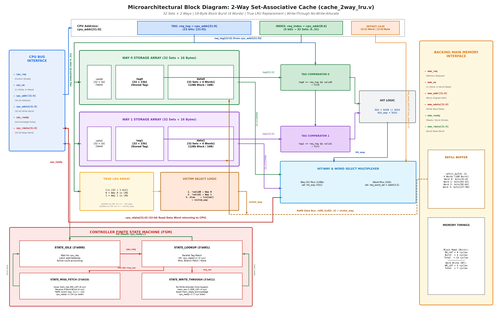

# Microarchitectural Block Diagram Guide: 2-Way Set-Associative Cache

**Project:** Project 7 – Cache Memory Subsystem Design (Phase I)  
**Author / Owner:** Member 5 (Report, Diagrams, Synthesis, Video Lead)  
**Target Module:** `rtl/cache_2way_lru.v`  
**Diagram Assets:**  
* High-Resolution Image (300 DPI): [`docs/img/block_diagram.png`](img/block_diagram.png)
* Native Editable Draw.io Source: [`docs/img/block_diagram.drawio`](img/block_diagram.drawio)
* Python Diagram Generator: [`scripts/make_block_diagram.py`](../scripts/make_block_diagram.py)

---

## 1. Architectural Overview & Block Diagram



The 2-way set-associative cache provides 1024 Bytes (1 KB) of high-speed L1 data storage organized into 32 sets of 2 ways each, with 16-byte blocks (4 words of 32 bits each). The datapath interfaces with a standard 32-bit microprocessor bus on the front end and a parameterized backing main memory controller on the back end.

---

## 2. Signal Walkthrough & Subsystem Breakdown

### A. 32-Bit CPU Address Split (`cpu_addr[31:0]`)
* **Tag Field (`req_tag = cpu_addr[31:9]`, 23 bits):** Uniquely identifies which 16-byte memory block is resident in the cache set.
* **Set Index Field (`req_index = cpu_addr[8:4]`, 5 bits):** Indexes one of the 32 sets ($\log_2(32) = 5$).
* **Block Offset Field (`cpu_addr[3:0]`, 4 bits):** 
  - `cpu_addr[3:2]` selects 1 of 4 32-bit words within the 16-byte block.
  - `cpu_addr[1:0]` byte offset (word-aligned `2'b00`).

### B. Parallel Storage Ways (Way 0 and Way 1)
Each set contains storage for two independent ways:
* **`valid0` / `valid1` (`32 × 1 bit`):** High when the cache line holds valid memory data.
* **`tag0` / `tag1` (`32 × 23 bits`):** Stores the 23-bit memory address tag.
* **`data0` / `data1` (`32 × 4 words = 128 bits`):** Stores four 32-bit words per line (16 Bytes).

### C. Parallel Tag Comparators & Hit Logic
Continuous continuous comparison occurs simultaneously on both ways:
```verilog
wire hit0 = valid0[req_index] && (tag0[req_index] == req_tag);
wire hit1 = valid1[req_index] && (tag1[req_index] == req_tag);
wire hit  = hit0 || hit1;
wire hit_way = hit1; // 0 = Way 0 hit, 1 = Way 1 hit
```

### D. Hit-Way & Word Select Multiplexer
On a read hit:
1. `hit_way` steers the 128-bit cache line from Way 0 or Way 1.
2. `req_word_sel` (`cpu_addr[3:2]`) selects the targeted 32-bit word and drives `cpu_rdata[31:0]`.

### E. True LRU & Victim Selection Logic
* **True LRU Array (`lru[32 × 1-bit]`):**
  - `lru[set] == 0`: Way 0 is LRU victim.
  - `lru[set] == 1`: Way 1 is LRU victim.
* **Victim Selection Priority:**
  ```verilog
  wire victim_way = (!valid0[req_index]) ? 1'b0 :
                    (!valid1[req_index]) ? 1'b1 :
                    lru[req_index];
  ```
  Invalid ways are populated before any valid line is evicted!
* **LRU Update Rules:**
  - Read/Write Hit: `lru[req_index] <= ~hit_way` (marks the accessed way MRU).
  - Block Refill: `lru[req_index] <= ~victim_way` (marks the refilled way MRU).
  - Write Miss: No change (bypasses cache).

### F. Controller FSM (4 States)
1. **`STATE_IDLE` (3'b000):** Awaits `cpu_req`, latches address/data/we.
2. **`STATE_LOOKUP` (3'b001):** Parallel tag check. Hit completes in **2 clock cycles** (`cpu_ready = 1`). On read miss, branches to fetch; on write, branches to store.
3. **`STATE_MISS_FETCH` (3'b010):** Awaits backing memory, collects 4-word burst in `refill_buf[0..3]`, refills victim way, and completes in **14 clock cycles**.
4. **`STATE_WRITE_THROUGH` (3'b011):** Forwards 32-bit store to backing memory without allocating (No-Write-Allocate), completing in **7 clock cycles**.

---

## 3. How to Open & Edit in Draw.io

1. Open [app.diagrams.net](https://app.diagrams.net/) in your web browser.
2. Click **Open Existing Diagram**.
3. Choose the file `docs/img/block_diagram.drawio` from this repository.
4. Modify or adjust any component as desired.
